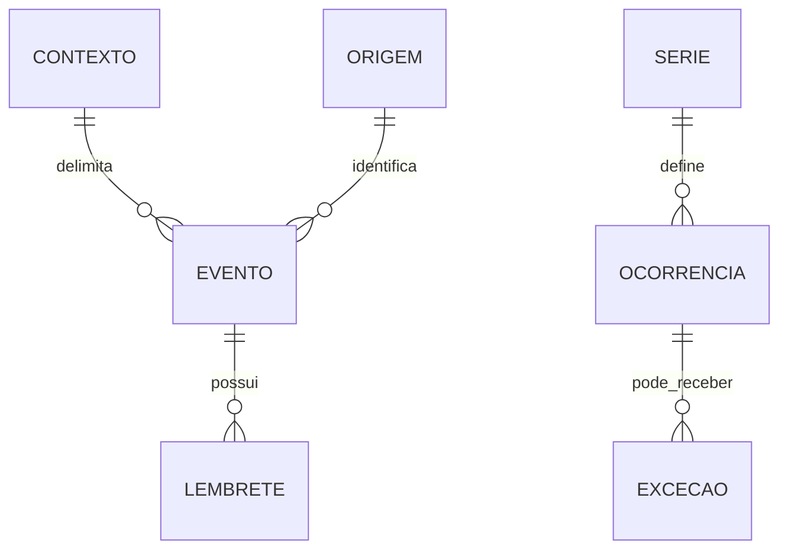

# Arakatu — Entidades e conceitos

**Natureza:** modelo conceitual derivado das capacidades existentes. Não fixa schema físico nem transforma dados plausíveis em campos obrigatórios aprovados.

| Conceito | Significado e limites |
| --- | --- |
| Agenda/calendário | Organização dos eventos pessoais ou compartilhados; multiplicidade e campos próprios ainda não definidos |
| Evento nativo | Criado e administrado no Kafofo, que permanece sua fonte de origem |
| Evento externo | Dado de origem externa apresentado no conjunto integrado; edição e propriedade local precisam de definição |
| Origem | Identificação de onde o evento veio, para manter interpretação clara na visão consolidada |
| Contexto | Pessoal, núcleo ou residência conforme aplicação da plataforma |
| Série recorrente | Regra de repetição diária, semanal, mensal ou anual |
| Ocorrência | Instância de uma série em determinado momento; alvo possível de edição/exclusão isolada |
| Exceção | Alteração/remoção de ocorrência sem modificar indevidamente o restante da série |
| Lembrete | Antecedência configurável associada ao evento, com múltiplos lembretes suportados |
| Fonte/assinatura externa | Vínculo de integração iCalendar; direção concreta e política de atualização ainda não especificadas |
| Exportação/importação | Operações de portabilidade iCalendar, distintas de atualização contínua por assinatura |

As relações ajudam a separar responsabilidades. Exceções podem ter outra representação física; eventos simples não exigem série. O diagrama não decide se lembretes são herdados por ocorrência nem se a fonte externa corresponde a tabela própria.

## Dados e invariantes conhecidos

Cada evento apresentado deve ter origem identificável e autorização aplicável. Evento criado no Kafofo permanece sob sua fonte; modificação externa não atualiza automaticamente esse original. Recorrência permite agir em uma ocorrência ou toda a série. Exceção isolada deve preservar as demais ocorrências. Múltiplos lembretes são suportados e respeitam preferências individuais.

## Dados a especificar

Título, descrição, local, início/fim, duração, eventos sem horário, obrigatoriedade dos campos, fuso de origem, proprietário, convidados e formato de identificadores externos não possuem esquema completo aprovado na fonte. Horário é necessário conceitualmente à agenda, mas a estrutura e validações concretas ainda precisam de definição.

Não criar status de tarefa, responsável financeiro ou checklist no evento por analogia com outros módulos. Excluir uma ocorrência não significa excluir toda série ou o calendário externo.
