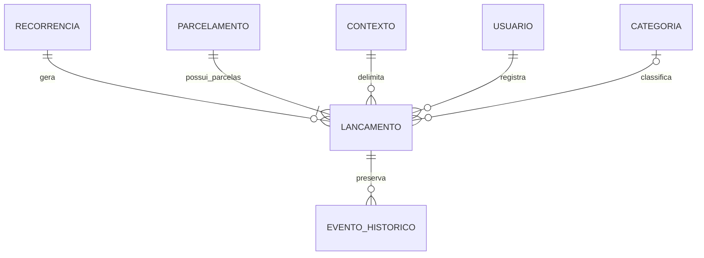

# Kapanga — Entidades e dados

**Natureza:** modelo conceitual derivado das definições funcionais. Não fixa tabelas, colunas ou endpoints.

## Conceitos

| Entidade/conceito | Definição |
| --- | --- |
| Despesa / lançamento | Unidade financeira com descrição, valor, lançamento, vencimento, contexto e situação de pagamento próprios |
| Despesa avulsa | Lançamento sem vínculo recorrente ou parcelado |
| Configuração de recorrência | Regra que calcula lançamentos semanais, mensais ou anuais continuamente até encerramento explícito |
| Ocorrência recorrente | Lançamento individual originado de configuração, com valor e estado independentes |
| Parcelamento / despesa original | Compromisso com quantidade finita de parcelas; mantém relação histórica com os lançamentos individuais |
| Parcela | Lançamento com número na sequência, total de parcelas, valor, vencimento e situação próprios |
| Categoria | Classificação predefinida ou personalizada por administrador do núcleo; categoria personalizada não se propaga entre núcleos |
| Forma de pagamento | Informação opcional: Dinheiro, Pix, Crédito, Débito, Boleto, Transferência ou outra forma |
| Registro de pagamento | Evento de quitação integral; não estabelece por si só um modelo de conta bancária ou movimento de caixa |
| Reversão | Evento administrativo que preserva pagamento anterior, registra motivo e desbloqueia os campos protegidos |
| Exclusão lógica | Estado de visibilidade operacional independente da situação financeira |
| Restauração | Recuperação administrativa de registro e, quando escolhido e permitido, de relacionados da cadeia |
| Contexto | Escopo pessoal, de núcleo ou residência; não se deduz apenas do autor do lançamento |
| Indicador | Agregação de lançamentos autorizados, calculada pelo Kapanga para o contexto correspondente |

## Dados conhecidos do lançamento

| Dado | Obrigatoriedade ou regra |
| --- | --- |
| Descrição | Obrigatória; editável mesmo após pagamento quando autorizado |
| Valor | Obrigatório; bloqueado enquanto PAGO |
| Data de lançamento | Registrada separadamente; bloqueada enquanto PAGO; preenchimento/edição inicial a especificar |
| Data de vencimento | Obrigatória, admite passado; bloqueada enquanto PAGO |
| Responsável pelo lançamento | Identificado automaticamente; transferência de autoria não definida |
| Situação financeira | PENDENTE, PAGO, REVERTIDO ou CANCELADO |
| Categoria | Associação disponível; obrigatoriedade não definida |
| Forma de pagamento | Opcional, mesmo que o registro possa ser pago; se informada, bloqueada enquanto PAGO |
| Contexto | Um contexto aplicável ao registro; mudança posterior de contexto não definida |
| Origem/vínculo | Recorrência ou parcelamento quando aplicável |
| Número da parcela e total de parcelas | Imutáveis desde a criação do parcelamento |
| Histórico e exclusão lógica | Preservam rastreabilidade; estrutura física e prazos específicos a refinar |

A fonte não especifica campo obrigatório de data efetiva do pagamento. Não confundir esse possível dado com lançamento, vencimento ou timestamp de auditoria. Valor mínimo, precisão, moeda e suporte a valores negativos não foram definidos.

## Relações conceituais

A cardinalidade opcional da categoria ilustra que sua obrigatoriedade não foi definida; não representa aprovação de regra de validação. Recorrência e parcelamento são origens alternativas; sua combinação não foi aprovada. O conceito de CONTEXTO não exige tabela genérica.

## Invariantes

1. Ocorrências e parcelas têm valores e situação independentes.
2. Pagamento só representa quitação integral; saldo parcial não existe no MVP.
3. Parcela paga não pode ser excluída por exclusão em cadeia; exclusão individual de despesa paga é permitida pela RN-092.
4. Número sequencial e quantidade total de parcelas não mudam, inclusive após exclusão de outra parcela.
5. Exclusão não redistribui valor entre parcelas.
6. Total do parcelamento deriva dos valores finais das parcelas; tratamento agregado de excluídos/cancelados permanece a definir.
7. Encerramento da recorrência interrompe geração futura e não apaga ocorrências existentes.
8. CANCELADO e exclusão lógica são dimensões independentes.
