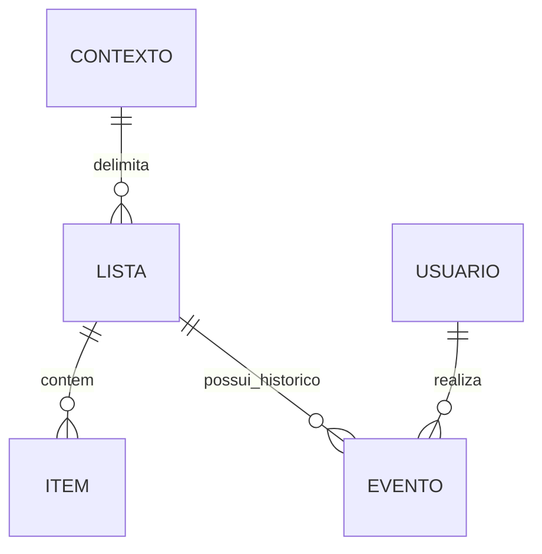

# Kitanda — Entidades e conceitos

> **Alpha 1:** consulte o [contrato aprovado deste incremento](alpha-1.md), que resolve ou adia explicitamente os pontos aplicáveis. O texto geral abaixo descreve o MVP; capacidades adiadas não são critérios de conclusão desta versão.

**Natureza:** modelo conceitual derivado; não fixa tabelas, campos técnicos ou endpoints.

| Conceito | Definição |
| --- | --- |
| Lista | Registro com nome obrigatório, descrição opcional e um único contexto; mantém itens e histórico |
| Item | Registro pertencente à lista, com nome obrigatório, quantidade/unidade/observação opcionais e situação pendente ou comprado |
| Contexto | Escopo pessoal, núcleo ou residência; delimita acesso e compartilhamento |
| Compartilhamento | Acesso explícito entre membros autorizados do contexto; sem externos ao núcleo |
| Ordenação | Organização manual dos itens compartilhada entre usuários autorizados da lista |
| Evento de histórico | Registro de operação com usuário e data/hora, respeitando contexto e privacidade |
| Exclusão lógica | Remoção da visualização operacional com preservação de histórico conforme política aplicável |
| Resumo/progresso | Contagem de itens pendentes/comprados e proporção comprada sem pesos |

## Dados conhecidos

| Registro | Dado | Regra |
| --- | --- | --- |
| Lista | Nome | Obrigatório e suficiente para identificação; unicidade não definida |
| Lista | Descrição | Opcional |
| Lista | Contexto | Exatamente um: pessoal, núcleo ou residência |
| Lista | Compartilhamento | Somente membros autorizados do contexto; mecanismo exato de concessão pendente |
| Item | Nome | Obrigatório; critério de igualdade para duplicados ainda não definido |
| Item | Quantidade | Opcional; tipo, precisão, limites e validação ainda não definidos |
| Item | Unidade de medida | Opcional; catálogo e conversões não aprovados |
| Item | Observação | Opcional; formatação não especificada nesta fonte |
| Item | Situação | Pendente ou comprado; marcação reversível |
| Item | Posição | Ordenação manual compartilhada; representação técnica livre |
| Histórico | Ator e momento | Obrigatórios para operações rastreadas |

Não há preço, marca ou fornecedor. Não presumir que o nome referencia um catálogo de produtos, que quantidade vazia vale 1 ou que unidade vazia possui valor padrão.

O contexto é conceito de domínio, não exigência de tabela genérica. Acesso ao histórico segue autorização da lista; ator registrado não é proprietário automático de todos os registros compartilhados.

## Invariantes

Uma lista pertence a um único contexto; alterações não afetam listas diferentes. Comprados permanecem na lista até remoção. Ordem manual é compartilhada. Quantidade/unidade não mudam o peso de um item no progresso. Limpar comprados preserva pendentes; esvaziar atinge todos. Reutilizar não apaga pendentes ou histórico. Exclusão da lista é lógica e permite restauração por usuário autorizado.
