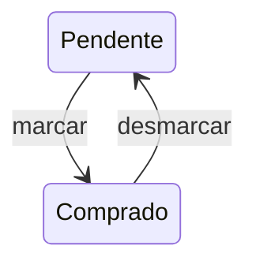

# Kitanda — Ciclo de listas e itens

> **Alpha 1:** consulte o [contrato aprovado deste incremento](alpha-1.md), que resolve ou adia explicitamente os pontos aplicáveis. O texto geral abaixo descreve o MVP; capacidades adiadas não são critérios de conclusão desta versão.

## Marcação de compra

Item pode ser marcado e desmarcado como comprado. Cada alteração registra quem e quando. Não exige confirmação ou justificativa. Item comprado permanece na lista, separado visualmente dos pendentes.

O diagrama representa situações de compra, sem incluir exclusão como uma terceira situação financeira ou de compra. Nomes de enums técnicos não foram definidos.

## Remoção e limpeza

| Operação | Alvo | Confirmação explicitamente definida | Efeito |
| --- | --- | --- | --- |
| Remover item individual | Item selecionado, inclusive comprado | Não especificada | Remover item do uso corrente e manter histórico conforme exclusão lógica |
| Limpar comprados | Todos os itens comprados | Sim | Remover comprados; preservar pendentes |
| Esvaziar lista | Todos os itens | Sim | Remover comprados e pendentes; manter lista e histórico |
| Excluir lista | Lista selecionada | Sim | Exclusão lógica, preservando histórico da lista e itens |
| Marcar/desmarcar | Item selecionado | Não | Alterar situação; preservar item e registrar evento |

Limpeza e esvaziamento são ações independentes. Não exigir justificativa para operações comuns por herança indevida das regras financeiras do Kapanga. Não foi definida confirmação para toda remoção individual; isso é detalhe de interface, não requisito aprovado.

## Exclusão e restauração da lista

Qualquer usuário com edição pode excluir a lista com confirmação. Histórico de lista e itens permanece. Usuário autorizado pode restaurar lista excluída logicamente.

A fonte não especifica restauração individual de itens nem como distinguir itens removidos antes da exclusão da lista daqueles ocultados pela exclusão da própria lista. A restauração da lista não autoriza recuperar automaticamente todos os itens já limpos anteriormente.

Plataforma adota retenção padrão de trinta dias configuráveis. O alcance exato dessa política sobre itens, históricos e recuperação exige refinamento conjunto. Não prometer recuperação indefinida nem remover fisicamente histórico na própria operação de limpeza.

## Reutilização

Lista pode continuar sendo usada após as compras: adicionar novos itens ou limpar comprados. Não exige encerramento ou arquivamento. Não apaga pendentes nem histórico anterior e não exige criar nova lista a cada compra.

Não foi aprovado um recurso de ciclos/sessões de compras, duplicação de lista, arquivamento obrigatório ou desmarcação coletiva automática ao reutilizar.
