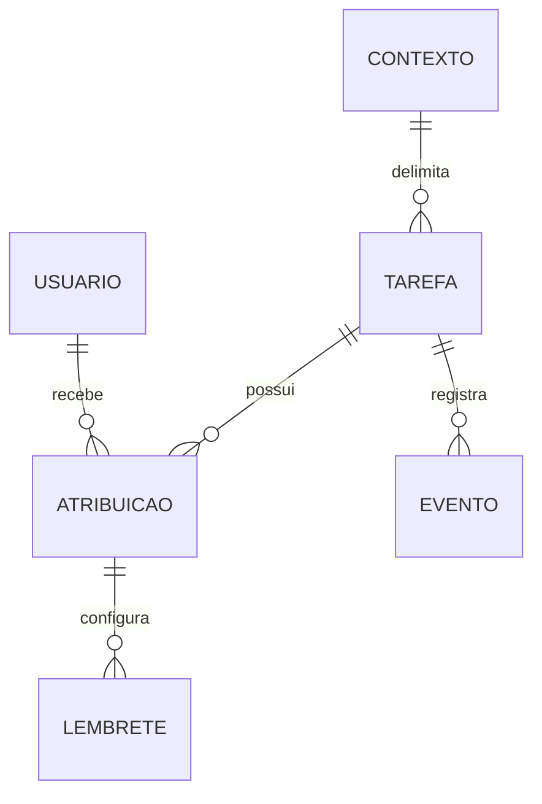

# Mutyrão — Entidades e conceitos

**Natureza:** modelo conceitual derivado; não fixa schema físico, tabelas, endpoints ou bibliotecas.

| Conceito | Definição |
| --- | --- |
| Tarefa | Unidade de atividade doméstica com nome, contexto, status, prioridade e histórico |
| Atribuição | Associação entre tarefa e responsável; pode haver zero, um ou vários responsáveis |
| Criador | Autor do cadastro; não possui edição exclusiva nem é responsável obrigatório por inferência |
| Contexto | Pessoal, núcleo ou residência; delimita autorização e visibilidade |
| Compartilhamento | Disponibilização a membros autorizados do contexto ou pessoas específicas, conforme regras aplicáveis |
| Categoria | Classificação predefinida ou personalizada do núcleo; opcional no cadastro |
| Descrição | Texto livre opcional com formatação básica e checkboxes interativos |
| Item de verificação | Checkbox na descrição; marcação não equivale à conclusão da tarefa |
| Lembrete individual | Configuração de antecedência de um responsável para tarefa com vencimento |
| Evento de histórico | Registro de alteração/ação, com dados específicos para conclusão, cancelamento, reabertura e atribuição |
| Período do quadro | Configuração de exibição de tarefas concluídas/canceladas; padrão de últimos trinta dias |
| Exclusão lógica | Ocultação operacional preservando registros históricos segundo a política da plataforma |

## Dados da tarefa

| Dado | Regra conhecida |
| --- | --- |
| Nome | Obrigatório |
| Descrição | Opcional; texto livre, negrito, itálico, listas, links e checkboxes |
| Contexto | Um contexto aplicável; transferência posterior não especificada |
| Responsáveis | Zero ou mais; adição, remoção e substituição disponíveis a qualquer momento conforme autorização |
| Status | Pendente, Em andamento, Concluída ou Cancelada; estado inicial explícito ainda não definido |
| Vencimento | Opcional; granularidade data/horário e fuso de referência a detalhar |
| Prioridade | Baixa, normal ou alta; padrão normal |
| Categoria | Opcional; possibilidade de predefinida ou personalizada; múltiplas categorias não aprovadas explicitamente |
| Criação/última atualização | Utilizadas para ordenação; eventos que atualizam timestamp precisam de refinamento |
| Justificativa de cancelamento | Obrigatória ao cancelar; visível a quem tem acesso à tarefa |
| Histórico | Preserva conclusões anteriores, reaberturas, cancelamentos e mudanças de responsáveis |

## Relações conceituais

A relação lembrete–atribuição indica configuração individual do responsável; não determina tabela física nem política ao remover e reatribuir alguém. Representação de checkboxes dentro do documento e existência de identificadores estáveis precisam de refinamento técnico.

## Invariantes

Uma tarefa pertence a um contexto e respeita compartilhamento. Não exige responsável, prazo, categoria ou descrição para cadastro. Responsáveis compartilham a mesma tarefa: conclusão altera o status integral, sem estados individuais. Checkboxes têm estado próprio e não concluem a tarefa automaticamente. Atraso é indicação visual derivada, não quinto status. Lembrete de um responsável não modifica configurações de outro.
