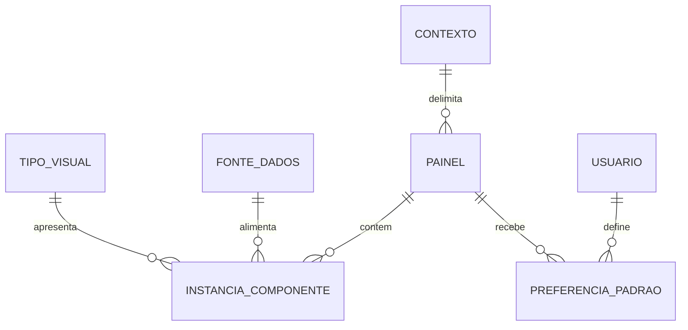

# Okape — Entidades e conceitos

**Natureza:** modelo conceitual derivado, sem fixar tabelas, pacotes ou endpoints.

| Conceito | Definição |
| --- | --- |
| Painel | Composição vinculada a um único contexto; começa vazia e pode estar ativa, desativada ou excluída logicamente |
| Proprietário pessoal | Pessoa com edição exclusiva de seu painel pessoal |
| Administração do painel | Criador ou administrador designado de painel compartilhado, enquanto autorizado |
| Compartilhamento pessoal | Concessão individual de visualização a conta da mesma instância |
| Contexto | Pessoal, núcleo ou residência; contexto compartilhado limita as fontes |
| Preferência de painel padrão | Escolha de cada usuário por contexto; cardinalidade por núcleo/residência concreta a refinar |
| Ordem de navegação | Organização manual definida pela tela de configuração; escopo individual/compartilhado ainda não detalhado |
| Conjunto/fonte de dados | Identificação, estrutura, tipos, configurações oferecidas e formatos de apresentação compatíveis |
| Tipo de componente visual | Item do catálogo fixo que declara quais estruturas e tipos de dados aceita |
| Instância de componente | Uso de um tipo visual com fonte, configuração e posição/tamanho próprios dentro de um painel |
| Layout | Grade responsiva controlada pelo Okape, com dimensões e posições de componentes |
| Estado de carregamento | Condição de apresentação: carregado, falha, sem acesso ou incompatível; nomes técnicos não aprovados |

## Relações

Uma fonte pode alimentar várias instâncias. Cada instância tem configuração independente. Compartilhar fonte não significa compartilhar configuração nem cache autorizado entre usuários.

## Dados conhecidos e lacunas

Cada fonte informa identificação, estrutura/tipos, opções de configuração e compatibilidade. Cada visual informa entradas aceitas. Cada instância precisa manter fonte/configuração e layout para preservar composição, inclusive quando falha.

Campos obrigatórios de painel, nome/descrição, formato de identificadores, modelo físico de administração e metadados de versão não foram definidos. Não exigir nome obrigatório, unicidade ou tamanho máximo como se fossem regras da fonte.

## Invariantes

Painel nasce vazio. Pessoal pode combinar contextos autorizados; compartilhado fica no próprio contexto. Consulta do painel não equivale a consulta dos dados. Edição pessoal é do proprietário; edição compartilhada do criador/designado. Cópia de componente é independente. Falha/acesso/incompatibilidade não removem componente automaticamente. Exclusão de composição não exclui dados de origem.
