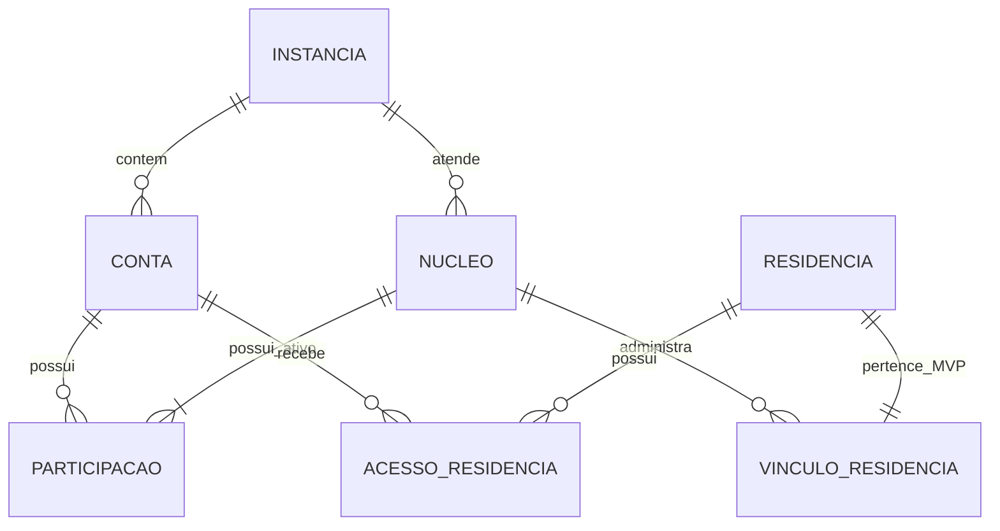

# Plataforma — Entidades e conceitos

> **Alpha 1:** consulte o [contrato aprovado deste incremento](alpha-1.md), que resolve ou adia explicitamente os pontos aplicáveis. O texto geral abaixo descreve o MVP; capacidades adiadas não são critérios de conclusão desta versão.

**Natureza:** modelo conceitual derivado dos requisitos. Não fixa tabelas, colunas, endpoints nem estrutura de pacotes.

## Glossário

| Conceito | Definição e dados conhecidos |
| --- | --- |
| Instância | Instalação autogerenciada; reúne configurações globais, contas, catálogo de módulos e núcleos |
| Conta / usuário | Identidade pessoal independente dos núcleos; nome de usuário e senha na ADR-0008; perfil e preferências individuais |
| Perfil | Nome de exibição e foto opcional; somente esses campos pessoais ficam visíveis aos demais membros |
| Núcleo doméstico | Unidade de administração e colaboração, com nome obrigatório, membros, configurações e permissões próprias |
| Participação no núcleo | Vínculo entre conta e núcleo; separa participação, moradia e responsabilidade administrativa |
| Residência | Espaço doméstico administrado por um núcleo no MVP; possui acessos e configurações próprios |
| Vínculo núcleo–residência | Associação conceitualmente própria, preparada para expansão futura; um único núcleo por residência no MVP |
| Acesso à residência | Vínculo de autorização com papel responsável, colaborador ou visualizador, independente do papel no núcleo |
| Contexto | Escopo pessoal, de núcleo ou de residência usado para interpretar operações e permissões |
| Compartilhamento seletivo | Concessão explícita sobre informação específica, quando permitida pelo módulo; não é um quarto tipo de proprietário |
| Convite | Link individual gerado por administrador de núcleo; validade padrão de sete dias e possibilidade de revogação |
| Sessão | Acesso autenticado consultável e encerrável; informações de navegador, sistema operacional, data e último acesso |
| Credencial temporária | Token/código de recuperação, uso único e validade limitada; não concede ao administrador a escolha da senha |
| Configuração de 2FA | Adesão opcional ao TOTP; mecanismo de recuperação ainda a detalhar |
| Módulo disponível | Módulo permitido pelo administrador global naquela instância |
| Módulo habilitado | Módulo escolhido pelo administrador do núcleo dentre os globalmente disponíveis |
| Integração | Conexão com serviço externo, com identidade, configuração e permissões próprias |
| Notificação | Comunicação dirigida a destinatário autorizado, com categoria, contexto, prioridade e controle de leitura |
| Preferência de notificação | Escolhas pessoais por canal, categoria, contexto e prioridade |
| Evento de auditoria | Registro de operação administrativa ou de segurança em escopo determinado; não se confunde com log técnico |
| Solicitação de exportação | Pedido de portabilidade com abrangência individual ou de núcleo; formato e execução ainda a especificar |
| Registro excluído logicamente | Registro fora do uso ativo, preservado pelo período de recuperação aplicável |

## Relações

As relações representam entidades ativas e regras do MVP. Participações e vínculos encerrados podem precisar continuar representados para preservar histórico. A forma física e a política de expurgo dependem de refinamento.

## Invariantes definidos

1. Uma conta pode participar de vários núcleos; sua identidade não é recriada para cada participação.
2. Um membro não precisa morar em uma residência para participar do núcleo.
3. Uma residência pertence a um único núcleo simultaneamente no MVP; um núcleo pode administrar várias residências.
4. Um núcleo ativo não pode ficar sem administrador.
5. Criação de residência não concede acesso automático a todos os membros do núcleo.
6. Papéis da residência não são deduzidos automaticamente do papel no núcleo.
7. Dados pessoais e dados dos núcleos permanecem conceitualmente separados.
8. Desativação de módulo preserva seus dados e não equivale a exclusão.
9. Contexto do registro e usuário autenticado, isoladamente, não bastam para comprovar autorização.

## Dados ainda não definidos

Não foram aprovados campos completos do cadastro de residência, cadastro de núcleo além do nome, formato de endereço, identificadores persistentes, enumerações de papéis de núcleo, schema de auditoria, quotas ou estrutura de armazenamento. Evitar preencher esses pontos como requisitos existentes.
