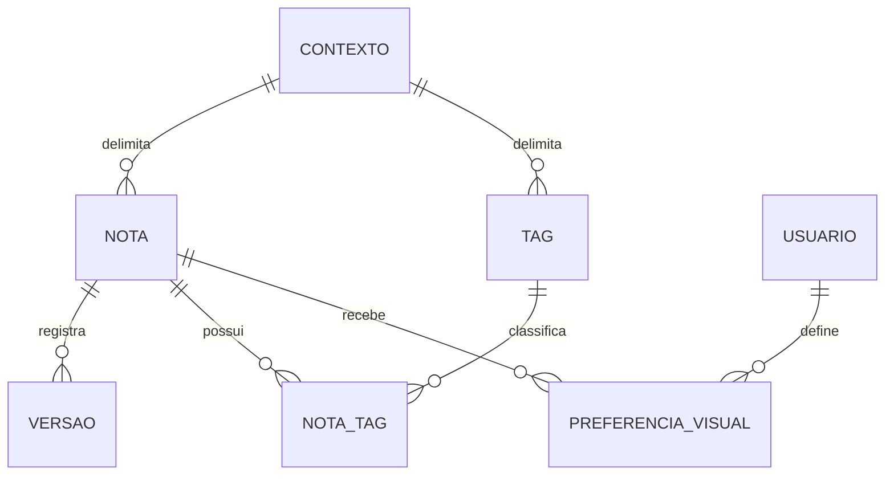

# Urukum — Entidades e dados

**Natureza:** modelo conceitual derivado, sem fixar tabelas, colunas ou endpoints.

| Conceito | Definição |
| --- | --- |
| Nota | Registro textual com contexto, conteúdo, título opcional, cor, datas, tags e estado |
| Versão da nota | Snapshot completo de cada edição, com autor, data/hora e informações relevantes; consultável no MVP |
| Tag | Identificação livre reutilizável em notas do mesmo contexto |
| Associação nota–tag | Uma tag pode classificar várias notas e uma nota pode ter várias tags |
| Preferência visual | Ordem e fixação por usuário, independentes por contexto |
| Estado da nota | Ativa, arquivada ou excluída |
| Lixeira | Área própria de consulta das notas excluídas logicamente |
| Paleta | Conjunto de cores predefinido pelo Kafofo; sem personalização livre |

## Dados conhecidos

| Dado | Regra |
| --- | --- |
| Título | Opcional |
| Conteúdo | Obrigatório e exclusivamente textual, com formatação prevista |
| Cor de fundo | Escolhida em paleta predefinida; é atributo da nota, não preferência individual expressa |
| Criação | Preenchida automaticamente |
| Última edição | Atualizada automaticamente; ações que contam como edição precisam de refinamento |
| Tags | Estrutura da fonte indica uma ou mais; regra para cadastro sem tag precisa de confirmação |
| Contexto | Um: pessoal, núcleo ou residência |
| Estado | Ativa, arquivada ou excluída; duplicata e restauração ficam ativas |
| Fixação | Individual por usuário; não pode alterar visualização dos demais |
| Ordem manual | Individual por usuário/contexto e salva automaticamente |

A estrutura inicial menciona fixação como dado da nota, mas as regras posteriores determinam independência por pessoa. O modelo conceitual a representa em preferência individual, sem impor schema físico.

Cardinalidades de versão e associação expressam relações conceituais, não política de quantas tags são obrigatórias na criação nem necessidade de criar versão inicial em um mecanismo específico.

## Invariantes

Nota pessoal é privada ao proprietário. Compartilhada exige acesso ao contexto. Tags não se propagam entre contextos. Conteúdo é obrigatório e título opcional. Cada edição gera versão completa. Ordem/fixação não alteram preferências alheias. Arquivar não exclui. Restaurar nota excluída retorna a ativa, recuperando conteúdo/tags/histórico. Consultar versão antiga não modifica nota atual.
