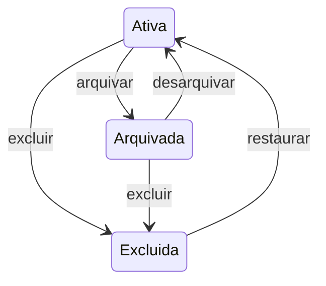

# Urukum — Estados, lixeira e recuperação

## Estados e transições definidas

| Operação | Resultado |
| --- | --- |
| Arquivar nota ativa | Arquivada, fora da grade principal e acessível na área de arquivadas |
| Desarquivar | Retorna à área principal, preservando conteúdo e histórico |
| Excluir nota | Excluída logicamente, fora das áreas ativa/arquivada e disponível na lixeira |
| Restaurar nota excluída | Retorna **ativa**, recuperando conteúdo, tags e histórico |
| Duplicar nota acessível | Cria outra nota **ativa**, com novo ID, criação e histórico próprio |

O diagrama organiza o ciclo definido; enums técnicos não foram escolhidos. Restauração retorna a ativa mesmo que a nota estivesse arquivada antes da exclusão, conforme seção 10.2 da fonte.

## Arquivamento

Preserva conteúdo e histórico, retira da grade principal e mantém área específica. Qualquer membro autorizado pode arquivar/desarquivar compartilhadas. Arquivar é estado compartilhado da nota; não é preferência individual de ocultação.

## Exclusão lógica e lixeira

Qualquer membro autorizado pode excluir compartilhada; pessoal permanece exclusiva do titular. Lixeira é própria do módulo. Excluída não aparece em ativas/arquivadas. Não foi exigida confirmação ou justificativa específica na fonte; não importar exigências financeiras como regra aprovada.

Consulta na lixeira e restauração respeitam contexto/permissões. Editar ou duplicar diretamente da lixeira não foi definido; não acrescentar essa possibilidade por inferência.

## Retenção

Padrão de trinta dias, configurável pelo administrador da instância. Histórico é preservado durante o período aplicável; após vencimento, notas podem ser removidas definitivamente conforme política global.

Não é apagamento incondicional exatamente no minuto em que completam trinta dias; momento de processamento, vínculos e backup precisam de política operacional. Retenção de notas excluídas não impõe automaticamente que versões de notas ativas sejam apagadas após trinta dias da edição.

## Preferências na recuperação

Posição e fixação devem respeitar preferências individuais de cada usuário. Restaurar não aplica a ordem do responsável pela operação aos demais. Tratamento de preferência inexistente, dispositivo diferente ou usuário que perdeu vínculo exige refinamento.

Recuperar nota excluída não é recuperar versão antiga; histórico continua só para consulta no MVP.
